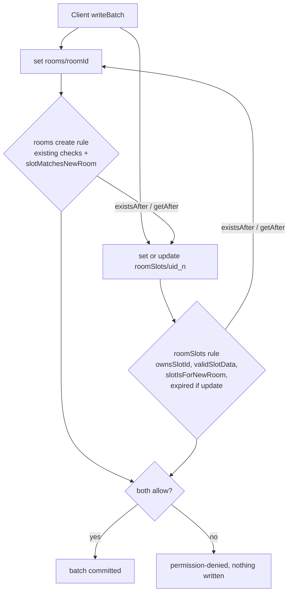
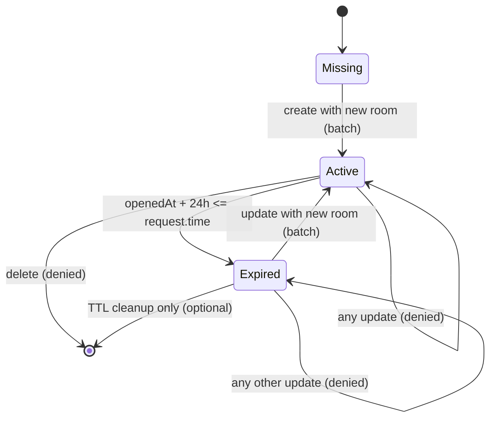

# Design Document: room-limit

## Overview

Each account can have at most 2 active rooms at a time. The limit is enforced only in `firestore.rules`. There are no Cloud Functions and the project stays on the Spark plan. This design covers `firestore.rules` and the emulator tests in `tests/rules`. It does not design or change client code. `createRoom` in `src` is updated separately by the user.

Firestore rules cannot count documents. Each account therefore owns two fixed slot documents, `roomSlots/{uid}_1` and `roomSlots/{uid}_2`. A room create is allowed only when the same batch also writes a valid slot for the caller that points at the new room. A slot can be rewritten only when it has expired, and only in a batch that creates a new room. Expiry is derived from the slot's stored `openedAt` plus 24 hours, never from TTL.

### Honest claims

The limit limits spam, not a hard guarantee. Anonymous accounts can be recreated, and a recreated account gets new slots. This design never describes the limit as unbypassable, complete, or a hard guarantee. In user-facing text, say "You can have up to 2 active rooms" and nothing stronger.

### Refinements to the base design

These points differ from, or tighten, the base sketch.

1. Slot rules use `let` bindings so each document is named once. This keeps the access-call count low (see Document-access budget).
2. `validSlotData` checks `roomId is string && size() >= 1` before the value is used in any path, so a malformed `roomId` produces a plain denial.
3. `slotMatchesNewRoom` only checks the slot as it will be after the batch (`existsAfter` / `getAfter`). The slot's own rule (`validSlotData`, `slotIsForNewRoom`, expiry check) checks everything else. The two rules cover each other: a room needs a slot, and a slot needs a new room.
4. Two rooms in one batch cannot share one slot. Each room's `slotMatchesNewRoom` compares the slot's `roomId` with its own id, and a slot holds one `roomId` (Requirement 2.8).
5. The `list` rule requires `resource.data.userId == request.auth.uid`. The client must query with `where('userId', '==', uid)`. The `get` rule is path based so reading a slot that does not exist yet returns "missing" instead of an error.
6. The test helper file is `tests/rules/roomLimitHelpers.ts`. It exists because every room create now needs a slot (see Existing tests).

## Architecture

Rules are evaluated per document write. In a batch, the room create and the slot write are each checked by their own rule, and both must pass or the whole batch is rejected.



Slot lifecycle:



Design decisions:

- Slot count is bounded by document IDs, not by counting. Only two IDs are writable per user.
- Expiry uses the stored `openedAt` and `request.time`. `expiresAt` on the slot exists for optional TTL cleanup only.
- `slot.expiresAt` equals the room's `expiresAt`, which is 24 to 26 hours after `request.time` under the existing room rule. TTL deletion therefore cannot remove a slot before it has expired. TTL is never read by an allow condition (Requirement 4.6).
- Rules run transactionally at commit. Two concurrent batches that target the same free slot cannot both pass, because the second sees the first slot as existing and active. The loser is denied.

### Client contract (not implemented here)

The user will update `createRoom` to: read both slots, choose a missing or expired one, write the room and that slot in one `writeBatch`, and if the batch is denied, tell the user plainly that they already have two active rooms. Until `createRoom` is updated, the real client's room create is denied by the new rules. This is expected.

### Related spec

The rooms-and-expiry TTL task should add `roomSlots` as a TTL collection group on `expiresAt`. It is an optional tidy-up. This spec does not edit that spec.

## Components and Interfaces

### firestore.rules additions

All existing rules stay. Two changes: one extra conjunct on `rooms` create, and a new `roomSlots` match block.

```
function ownsSlotId(slotId) {
  return isAuthed()
    && slotId in [request.auth.uid + '_1', request.auth.uid + '_2'];
}

function slotPath(slotId) {
  return /databases/$(database)/documents/roomSlots/$(slotId);
}

// Used by the rooms create rule: the slot, as it will be after the batch.
function slotMatchesNewRoom(slotId, roomId) {
  let p = slotPath(slotId);
  return existsAfter(p)
    && getAfter(p).data.roomId == roomId
    && getAfter(p).data.userId == request.auth.uid
    && getAfter(p).data.openedAt == request.time;
}

// Used by the roomSlots rules: the referenced room must be new in this batch.
function slotIsForNewRoom(roomId) {
  let rp = /databases/$(database)/documents/rooms/$(roomId);
  return !exists(rp)
    && existsAfter(rp)
    && getAfter(rp).data.createdBy == request.auth.uid
    && getAfter(rp).data.openedAt == request.time;
}

function validSlotData() {
  let d = request.resource.data;
  return d.keys().hasAll(['userId', 'roomId', 'openedAt', 'expiresAt'])
    && d.keys().hasOnly(['userId', 'roomId', 'openedAt', 'expiresAt'])
    && d.userId == request.auth.uid
    && d.roomId is string
    && d.roomId.size() >= 1
    && d.openedAt == request.time
    && d.expiresAt == getAfter(/databases/$(database)/documents/rooms/$(d.roomId)).data.expiresAt;
}

function slotExpired(prev) {
  return prev.openedAt + duration.value(86400, 's') <= request.time;
}

match /roomSlots/{slotId} {
  allow get:    if ownsSlotId(slotId);
  allow list:   if isAuthed() && resource.data.userId == request.auth.uid;
  allow create: if ownsSlotId(slotId)
                && validSlotData()
                && slotIsForNewRoom(request.resource.data.roomId);
  allow update: if ownsSlotId(slotId)
                && slotExpired(resource.data)
                && request.resource.data.roomId != resource.data.roomId
                && validSlotData()
                && slotIsForNewRoom(request.resource.data.roomId);
  allow delete: if false;
}
```

Room create gets one extra conjunct, placed after the existing conditions:

```
&& (slotMatchesNewRoom(request.auth.uid + '_1', roomId)
    || slotMatchesNewRoom(request.auth.uid + '_2', roomId))
```

Notes on behavior:

- A pre-existing slot cannot satisfy `slotMatchesNewRoom` because its `openedAt` is earlier than this `request.time` and its `roomId` differs.
- A slot that points at someone else's existing room fails `slotIsForNewRoom` because `!exists(rp)` is false.
- If `openedAt` is missing or not a timestamp on the stored slot or on the room, the comparison errors and the write is denied (Requirement 8.6).
- Time comparisons use strict "less than" for open and "less than or equal" for expired, matching `roomIsOpen` (Requirements 8.4, 8.5).

### Document-access budget

Firestore limits the number of document-access calls (`get`, `exists`, `getAfter`, `existsAfter`) per rules evaluation. The commonly documented limits are 10 per single-document request and 20 per multi-document or batched request, with the 10 limit also applying to each operation. Verify against the current Firebase documentation before relying on these numbers. Duplicate accesses to the same document are documented as counted once, which is also to be verified. The table below assumes no deduplication, so it is a worst case.

| Operation | Accesses | Worst-case count |
|---|---|---|
| Room create | `users/{uid}` via `ageBand()` (1), slot `_1` existsAfter + getAfter x3 (4), slot `_2` existsAfter + getAfter x3 (4) | up to 9, then 1 when `_1` short-circuits |
| Slot create | `exists(room)`, `existsAfter(room)`, `getAfter(room)` x2 (createdBy, openedAt), `getAfter(room)` for expiresAt | up to 5 |
| Slot update | same as create; `resource` is free | up to 5 |
| Batch: room create + slot write | sum of the two | up to 14 |

Room create has two `slotMatchesNewRoom` calls joined by `||`, each with 4 accesses, plus the user doc. Bind with `let` inside the function to cut the `getAfter` repeats if the emulator reports an overrun. A test runs the worst-case valid batch (see Testing Strategy) so an overrun shows up in the emulator.

### Test helpers: tests/rules/roomLimitHelpers.ts

Existing helpers in `tests/rules/helpers.ts` stay unchanged: `userADb`, `userBDb`, `unauthDb`, `adminDb`, `clearData`, `getEnv`, `teardown`. The new file builds on them.

```ts
import type { Firestore } from 'firebase/firestore'

export interface BatchOptions {
  uid: string                          // 'userA' or 'userB'
  roomId: string
  slotId: string                       // e.g. 'userA_1'
  roomOverrides?: Record<string, unknown>   // merged over the valid room data
  slotOverrides?: Record<string, unknown>   // merged over the valid slot data
  omitSlot?: boolean                   // room only, no slot write
  omitRoom?: boolean                   // slot only, no room write
}

/** Build the writeBatch: room (openedAt serverTimestamp, expiresAt now + 25h) plus slot.
 *  Returns the batch; the caller calls assertSucceeds(batch.commit()) or assertFails. */
export function createRoomBatch(db: Firestore, opts: BatchOptions): WriteBatch

/** Seed a slot through the admin context with a backdated openedAt.
 *  ageSeconds: how long ago the slot opened. expiresAt is set to openedAt + 25h. */
export async function seedSlot(
  admin: Firestore,
  uid: string,
  n: 1 | 2,
  opts: { roomId?: string; ageSeconds: number },
): Promise<void>

/** Seed the users/{uid} document (18_plus) that ageBand() needs. */
export async function seedUser(admin: Firestore, uid: string): Promise<void>
```

Room data built by `createRoomBatch` matches the existing room create rule: `type`, `title`, `maturityLabel`, `categories`, `openedAt: serverTimestamp()`, `expiresAt: Timestamp now + 25 h`, `createdBy: uid`, `postingParticipantCount: 0`. Slot data: `userId`, `roomId`, `openedAt: serverTimestamp()`, `expiresAt` equal to the room's `expiresAt`. To test a slot whose `openedAt` differs from `request.time`, pass `slotOverrides: { openedAt: Timestamp.fromMillis(...) }`.

### Existing tests

After this change every room create needs a slot. Any existing test in `tests/rules` that creates a room through an authenticated context must switch to `createRoomBatch`. A search of `tests/rules` found no such test today: `smoke.test.ts` only reads the `rooms` collection while unauthenticated. The rooms-and-expiry spec's future room tests must use the helper.

## Data Models

### roomSlots/{uid}_1 and roomSlots/{uid}_2

| Field | Type | Rule |
|---|---|---|
| `userId` | string | equals `request.auth.uid` |
| `roomId` | string, length >= 1 | on create or reuse, the id of the room created in the same batch |
| `openedAt` | timestamp | equals `request.time` on every write |
| `expiresAt` | timestamp | equals the new room's `expiresAt`; TTL cleanup only |

Exactly these four fields. No other fields.

Derived values, never stored:

- Active slot: `request.time < openedAt + 24 h`.
- Expired slot: `openedAt + 24 h <= request.time`.

### Slot states per user

Each of the two slots is Missing, Active or Expired. A room create may target a slot that is Missing or Expired. The limit holds because only two IDs are writable and an Active slot cannot be rewritten.

### Access summary

| Operation | Allowed when |
|---|---|
| get | the caller is the owner (path prefix) |
| list | authenticated and `resource.data.userId == request.auth.uid` (query filtered by own uid) |
| create | owner id, valid data, room is new in the batch |
| update | owner id, slot expired, new `roomId`, valid data, room is new in the batch |
| delete | never |

## Correctness Properties

*A property is a characteristic or behavior that should hold true across all valid executions of a system-essentially, a formal statement about what the system should do. Properties serve as the bridge between human-readable specifications and machine-verifiable correctness guarantees.*

These properties are checked against the Firestore emulator. Property-based runs use `numRuns <= 20` because each run calls the emulator (Requirement 6.11). Generated ages avoid the exact 24-hour boundary.

### Property 1: Slot id and field shape

For any slot write by an authenticated user, the write is accepted only when the document ID is the caller's uid followed by `_1` or `_2`, the data has exactly the fields `userId`, `roomId`, `openedAt`, `expiresAt`, `userId` equals the caller, `openedAt` equals `request.time`, `roomId` is a non-empty string and `expiresAt` equals the new room's `expiresAt`. For any write that differs from this in exactly one of these conditions, the write is rejected and stored slots are unchanged.

**Validates: Requirements 1.1, 1.3, 1.4, 1.5, 1.6, 1.7, 1.8, 2.7, 3.7, 5.4**

### Property 2: Room create requires a matching slot in the same batch

For any room create by an authenticated user, the create succeeds only when the same batch writes a slot for the caller whose `roomId` equals the new room's id and whose `openedAt` equals the new room's `openedAt`. For any batch that creates two rooms and writes one slot, at most one room can match, so the batch is rejected and nothing is written.

**Validates: Requirements 2.1, 2.2, 2.3, 2.4, 2.8**

### Property 3: A slot must reference a new room owned by the caller

For any slot write whose `roomId` refers to a room that already exists, or to a room not created by the caller in the same batch, the write is rejected. The same slot data pointing at the room created in the batch is accepted.

**Validates: Requirements 2.5, 2.6**

### Property 4: At most two active slots per user

For any initial state of a user's two slots, where each is Missing, Active or Expired with a non-boundary age, and for any sequence of room-create attempts that target a slot ID, an attempt succeeds if and only if the targeted slot is Missing or Expired. After any sequence of successful creates, the number of Active slots for the user is at most 2, and a failed attempt writes no room and changes no slot.

**Validates: Requirements 3.1, 3.2, 3.3, 3.4, 3.6, 3.8**

### Property 5: Expired slot reuse only inside a room-create batch

For any Expired slot, an update succeeds only when it is in a batch that creates a new room, sets `openedAt` to `request.time`, and sets a `roomId` that differs from the stored one and matches the new room. An update outside such a batch, with the same `roomId`, or with `openedAt` not equal to `request.time` is rejected and the slot is unchanged.

**Validates: Requirements 4.3, 4.4, 4.5**

### Property 6: Slots are never deleted and unexpired slots are never updated

For any slot, any client delete is rejected and the slot still exists. For any Active slot, any update with any field mutation or any timestamp value is rejected and the stored slot is unchanged.

**Validates: Requirements 4.1, 4.2**

### Property 7: Slot privacy

For any slot owned by user A, a get by user A succeeds, and a get by user B or by an unauthenticated client is rejected. For any list query on `roomSlots`, the query succeeds only when it is restricted to the caller's own `userId`. An unrestricted list is rejected as a whole.

**Validates: Requirements 5.1, 5.2, 5.3, 5.5, 5.6, 5.7**

### Property 8: Expiry is derived only from openedAt

For any slot with stored `openedAt` and any stored `expiresAt`, the slot counts as Expired exactly when `openedAt + 24 h <= request.time`, regardless of the `expiresAt` value. A slot whose `expiresAt` is in the past but whose `openedAt` is recent is still Active. A slot whose `openedAt` is missing or not a timestamp causes dependent writes to be rejected.

**Validates: Requirements 3.5, 4.6, 8.4, 8.5, 8.6**

### Property 9: Scope limited to rules, tests and docs

For any file changed by the implementation of this spec, the file is `firestore.rules`, a file in `tests/rules`, a documentation file, or a steering file. No file under `src` changes, and no Cloud Functions are added. This is checked once against the git diff, not by a generated test.

**Validates: Requirements 8.1, 8.2, 8.3**

## Error Handling

| Situation | Rules result | Client-side handling (separate work) |
|---|---|---|
| Third room while two slots are active | whole batch denied, `permission-denied` | tell the user they already have two active rooms |
| Room without slot, or slot without room | whole batch denied | programming error; fix the batch |
| Two tabs race for the same free slot | the second batch is denied | re-read slots and retry once, or show the same message |
| Slot field malformed | whole batch denied | programming error |
| Rules access-call overrun | write denied with `permission-denied` | would look like a limit denial; the worst-case emulator test guards against it |
| Unauthenticated slot access | denied | not applicable |

A denial gives no detail about which condition failed. Test names and failure messages in this spec carry that detail instead.

## Testing Strategy

PBT applies to the limit and immutability rules because their outcomes vary with slot state, ages and field mutations. Plain read, privacy and shape checks are example-based, because one valid case and one denied case show the behavior. Tests run with `npm run test:emulator`.

### Rules for every test

- Contexts come only from `userADb`, `userBDb`, `unauthDb` and `adminDb` in `tests/rules/helpers.ts` (Requirement 6.12).
- `clearData()` runs in `beforeEach`, so each test starts empty (Requirement 6.13). Property bodies call `clearData()` at the start of each generated run.
- `request.time` cannot be faked in the emulator. Expiry is tested by seeding slots with a backdated `openedAt` through `adminDb`. Active uses 23 hours ago, expired uses 24 hours plus 1 minute ago. Generated ages avoid the exact 24-hour boundary.
- Every denial test has a positive control that differs only in the condition under test (Requirement 6.1).
- After a denied batch, `adminDb` reads confirm the room and slot do not exist (Requirements 2.2, 6.3).

### Example tests: tests/rules/roomLimit.test.ts

Each line is a denial with its positive control.

| Test | Denied case | Positive control |
|---|---|---|
| First room | n/a | room + `userA_1` allowed |
| Second room | n/a | second room + `userA_2` allowed while `_1` active |
| Third room | both slots active, denied, nothing written (adminDb) | `_1` backdated past 24 h, same batch allowed (slot reuse) |
| Room without slot | room only | same room with slot |
| Slot for another user's room | slot `roomId` is an existing room of userB | slot `roomId` is the new room in the batch |
| Wrong slot id | `userB_1` or `userA_3` written by userA | `userA_1` |
| Slot fields | extra field, missing field, renamed field | exactly four fields |
| Slot `openedAt` | backdated or future timestamp | `serverTimestamp()` |
| Slot `expiresAt` | not equal to room `expiresAt` | equal |
| Slot `roomId` | empty string, non-string | valid string |
| Privacy | userB get, userB write, unauth get: all denied | userA get allowed |
| List | list without `userId` filter denied | list filtered by own uid allowed |
| Delete | userA deletes own slot; slot still exists via adminDb | n/a |
| Update unexpired slot | denied | expired slot update in a room-create batch allowed |
| Update expired slot outside batch | denied | same update inside a room-create batch allowed |
| Reuse with same `roomId` | expired slot rewritten with its old `roomId`, denied | new `roomId` allowed |
| Two rooms, one slot | two room creates plus one slot, denied | two rooms plus two slots allowed |
| Worst-case batch | n/a | room create that targets `_2` with `_1` active and a user doc present, must succeed; guards the access-call budget |
| Slot expiresAt in the past | slot with recent `openedAt` and past `expiresAt` still blocks a third room | n/a |

### Property tests: tests/rules/roomLimit.property.test.ts

Both properties are required, not optional. Each uses `fast-check` with `numRuns` at or below 20 (Requirements 6.10, 6.11).

**Property 4 test, limit model.** Generate a state for slot 1 and slot 2, each Missing, Active (age 1 minute to 23 hours) or Expired (age 24 hours plus 1 minute to 48 hours). Seed them with `seedSlot`. Generate a short sequence (1 to 4) of room-create attempts, each targeting slot 1 or slot 2. Keep a simple model: an attempt succeeds iff the targeted slot is Missing or Expired in the model, and a success makes it Active. After each attempt, assert the emulator result equals the model, and that the number of Active slots read through `adminDb` is at most 2.

Tag: **Feature: room-limit, Property 4: At most two active slots per user**

**Property 6 test, slot immutability.** Seed an Active slot. Generate a random mutation: change, drop or add a field, with random timestamps (past, future, near `openedAt`) and random `roomId` values. Assert that every client update is denied, that a delete is denied, and that the stored slot read through `adminDb` equals the seeded one.

Tag: **Feature: room-limit, Property 6: Slots are never deleted and unexpired slots are never updated**

The other properties (1, 2, 3, 5, 7, 8) are covered by the example table above, with the variants in Property 1 covering random field and id mutations by example. The git-diff check for Property 9 is a manual step in the final review.

### Documentation checks

- The exact phrase "limits spam, not a hard guarantee" appears in this design, in the `docs/build-log.md` entry, and in `safety-and-claims.md` (Requirement 7.1).
- The anonymous-account caveat appears in the same three places (Requirement 7.2).
- No document or user-facing string claims the limit is unbypassable, complete or a hard guarantee (Requirement 7.4). A grep for those words is part of the final check.

### Build-log entry text

> **Room limit (room-limit spec).** Each account can have at most 2 active rooms. Enforcement is in `firestore.rules` only: each user has two slot documents, `roomSlots/{uid}_1` and `roomSlots/{uid}_2`, and a room can only be created in the same batch as a slot write. No Cloud Functions are used and the project stays on the Spark plan. The limit limits spam, not a hard guarantee: anonymous accounts can be recreated, and a recreated account gets new slots. Client `createRoom` is updated separately; until then room creates are denied by the new rules. Rules tests run in the emulator with fast-check (20 runs or fewer per property).
